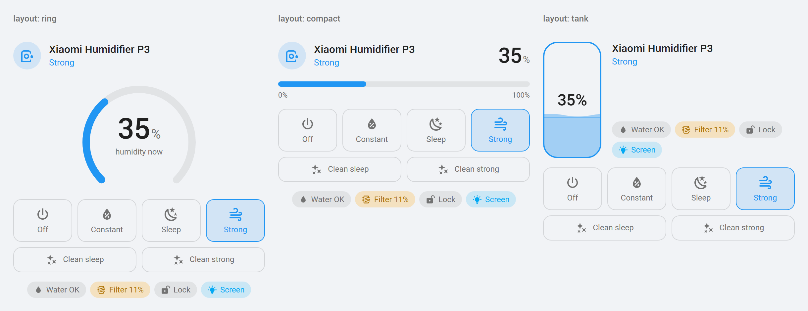

# Xiaomi P3 Humidifier Card

A Home Assistant dashboard card for the Xiaomi Humidifier P3. One card replaces a stack of
`mod-card`, Mushroom, `button-card`, `config-template-card` and `slider-entity-row`.



- Three layouts, switchable in the card settings: **ring**, **compact** and **tank**.
- Colour follows the device state: grey (off), blue (humidifying), green (fan only), purple (clean loop).
- Mode buttons: Off, Constant, Sleep, Strong, plus optional Clean sleep / Clean strong with the minutes left.
- Target humidity appears only in Constant mode: a slider in every layout, and a draggable handle on the ring.
- Optional status chips: water, filter life, child lock and screen (the last two toggle on tap).
- Visual editor, light and dark themes, English and Ukrainian.

It works with any `humidifier` entity. The clean loop, chips and scripts are optional extras.

## Installation

### HACS (recommended)

1. Open HACS, then the menu in the top right corner, then **Custom repositories**.
2. Add `https://github.com/VahaC/xiaomi-p3-humidifier-card` with the type **Dashboard**.
3. Find **Xiaomi P3 Humidifier Card** in HACS and press **Download**.
4. Reload the browser page.

HACS shows new releases as updates from then on.

### Manual

1. Download `xiaomi-p3-humidifier-card.js` from the [latest release](https://github.com/VahaC/xiaomi-p3-humidifier-card/releases/latest).
2. Copy it to `config/www/`.
3. Add `/local/xiaomi-p3-humidifier-card.js` as a **JavaScript module** under
   **Settings → Dashboards → Resources**.

## Usage

Add the card from the dashboard card picker ("Xiaomi P3 Humidifier Card"). The picker fills in
the usual P3 entity and helper names it finds in your system. Everything can be changed in the
visual editor.

Minimal YAML:

```yaml
type: custom:xiaomi-p3-humidifier-card
entity: humidifier.xiaomi_p3_10fb_humidifier
```

Full YAML:

```yaml
type: custom:xiaomi-p3-humidifier-card
entity: humidifier.xiaomi_p3_10fb_humidifier
name: Xiaomi Humidifier P3
layout: ring # ring | compact | tank
switch_entity: switch.xiaomi_p3_10fb_switch_status
dry_time_entity: sensor.p3_fan_dry_time
clean_loop_entity: input_boolean.p3_clean_loop
clean_mode_entity: input_select.p3_clean_mode
water_entity: sensor.p3_water_status
filter_entity: sensor.xiaomi_p3_10fb_filter_life_level
lock_entity: switch.xiaomi_p3_10fb_physical_control_locked
screen_entity: switch.xiaomi_p3_10fb_switch_status_2
off_script: script.p3_clean_stop
constant_script: script.p3_mode_constant
sleep_script: script.p3_mode_sleep
strong_script: script.p3_mode_strong
clean_sleep_script: script.p3_clean_start_sleep
clean_strong_script: script.p3_clean_start_strong
```

## Options

| Option | Default | Description |
| --- | --- | --- |
| `entity` | required | The `humidifier` entity. |
| `name` | friendly name | Card title. |
| `layout` | `ring` | `ring`, `compact` or `tank`. |
| `switch_entity` | | Switch that is `off` while the device only runs its fan. |
| `dry_time_entity` | | Sensor with the minutes left in the clean loop. |
| `clean_loop_entity` | | `input_boolean` that is `on` while the clean loop runs. |
| `clean_mode_entity` | | `input_select` with the clean loop mode. |
| `water_entity` | | Water status sensor. Adds the water chip. |
| `water_ok_state` | `Normal` | State of `water_entity` that means there is enough water. |
| `filter_entity` | | Filter life sensor in percent. Adds the filter chip. |
| `filter_warning` | `15` | The filter chip turns into a warning below this percentage. |
| `lock_entity` | | Child lock switch. Adds a chip that toggles it. |
| `screen_entity` | | Screen switch. Adds a chip that toggles it. |
| `off_script` | | Script for the Off button. Without it the card calls `humidifier.turn_off`. |
| `constant_script`, `sleep_script`, `strong_script` | | Scripts for the mode buttons. Without them the card calls `humidifier.set_mode`. |
| `clean_sleep_script`, `clean_strong_script` | | Scripts for the Clean buttons. A button is shown only when its script is set. |
| `constant_mode`, `sleep_mode`, `strong_mode` | `Constant Humidity`, `Sleep`, `Strong` | Mode names as reported by the humidifier `mode` attribute. |
| `clean_sleep_option`, `clean_strong_option` | `Sleep`, `Strong` | Option names of `clean_mode_entity`. |

## How the state is derived

1. `clean_loop_entity` is `on` → **Clean sleep** or **Clean strong**, by `clean_mode_entity`.
2. The humidifier is `on` and `switch_entity` is `off` → **Fan only**.
3. The humidifier is `on` → **Constant**, **Sleep** or **Strong**, by its `mode` attribute.
4. Otherwise → **Off**.

Current humidity comes from the `current_humidity` attribute (or `environment.relative_humidity`),
the target from `humidity`, and the slider limits from `min_humidity` / `max_humidity`.

## Theming

The state colours follow the theme and can be overridden with CSS variables:

| Variable | Fallback |
| --- | --- |
| `--p3-on-color` | `--blue-color` |
| `--p3-fan-color` | `--green-color` |
| `--p3-clean-color` | `--purple-color` |
| `--p3-off-color` | `--state-inactive-color` |

## Development

```bash
npm install
npm run build   # writes dist/xiaomi-p3-humidifier-card.js
npm run demo    # demo page with a mocked Home Assistant on http://localhost:5173
```

A release is built by GitHub Actions: publishing a GitHub release attaches
`xiaomi-p3-humidifier-card.js` to it, which is the file HACS downloads.

## License

MIT
